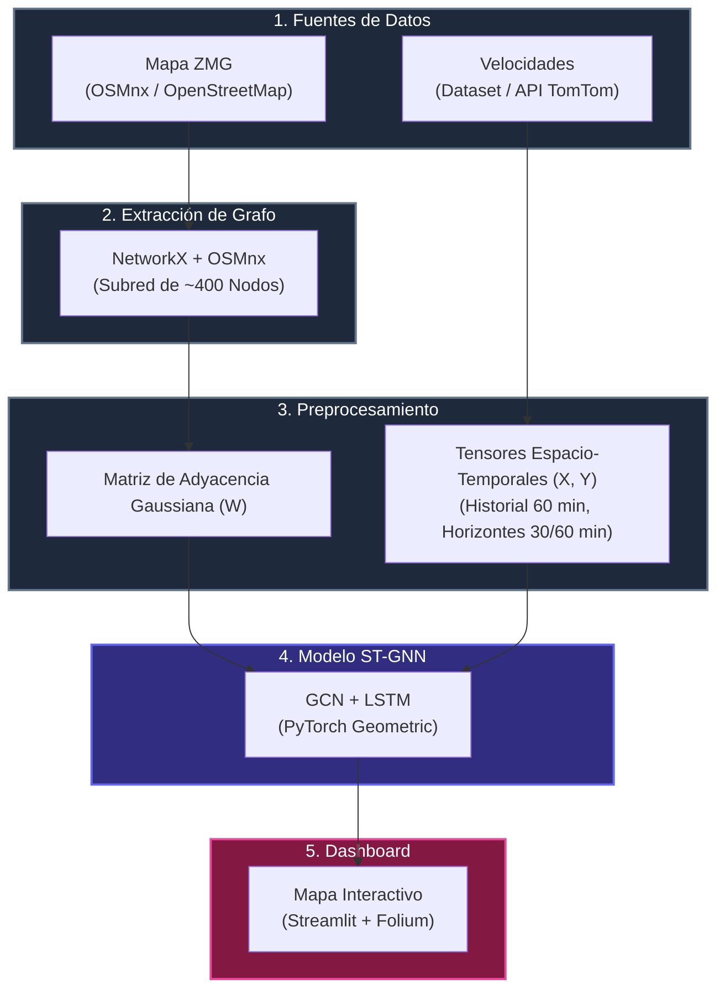

# Sistema de Predicción Espacio-Temporal de Tráfico Urbano (ZMG)

<sub>**Autores:** Irving Gael Robles Ventura // Angel Emmanuel Moreno Velasco</sub>

Sistema de pronóstico multi-horizonte de congestión y velocidades vehiculares sobre la red vial principal de la Zona Metropolitana de Guadalajara (ZMG), implementando Redes Neuronales Convolucionales sobre Grafos y Redes Recurrentes (ST-GNN: GCN + LSTM).

---

## 1. Visión general y problemática

### 1.1 Contexto
En el área metropolitana de Guadalajara habitan alrededor de 5.6 millones de personas, con una de las tasas de motorización más altas del país ~82% de posesión vehicular. Esto ha desembocado en una severa congestión vial en las arterias principales (Av. López Mateos, Av. Vallarta, Carretera a Chapala, Periférico, etc.).

La congestión vial no es un fenómeno aislado por calle, sino un _sistema en red altamente acoplado:_ un accidente, una obra o un cuello de botella en un punto se propaga rápidamente a través de las vías secundarias y terciarias.

### 1.2 Oportunidad y Enfoque
Este proyecto implementa un modelo espacio-temporal sobre grafos (**ST-GNN**) que modela simultáneamente:
- **El Espacio:** La estructura física de las avenidas, sus interconexiones y distancias viales reales (Grafo Vial).
- **El Tiempo:** El historial de velocidades y su tendencia temporal (Serie Temporal).

A diferencia de los enfoques tradicionales que analizan sensores aislados o no consideran la propagación topológica del tráfico, este enfoque maneja la conectividad espacial y el flujo temporal del tráfico.

---

## 2. Objetivos del Sistema

1. **Predicción Directa Multi-Horizonte:** Estimar las velocidades y niveles de congestión a _30 y 60 minutos_ hacia el futuro de forma simultánea, evitando la acumulación de error de los modelos autorregresivos iterativos.
2. **Plataforma Visual Interactiva:** Proveer un dashboard interactivo en tiempo real que permita visualizar las velocidades y niveles de congestión estimados en la red.
3. **Validación Metodológica:** Comparar el rendimiento del modelo frente a enfoques clásicos (Promedio Histórico, Modelo Persistente, LSTM univariada). 

### 2.1 Alcance y Cobertura
- **Región:** Zona Metropolitana de Guadalajara (ZMG), México.
- **Topología:** Subred vial aproximada de 350 a 400 nodos representativos sobre corredores primarios y secundarios (`motorway`, `primary`, `secondary`).
- **Granularidad Temporal:** Muestreo aproximadamente cada 5 minutos, lo que permite capturar cambios significativos en el flujo de tráfico.

---

## 3. Arquitectura del Sistema



---

## 4. Fundamentos Teóricos y Modelado Matemático

### Matriz de Adyacencia Gaussiana Ponderada ($W$)
En lugar de una matriz binaria convencional ($\{0, 1\}$), se modela una **Matriz de Adyacencia Gaussiana Ponderada** ($W \in \mathbb{R}^{N \times N}$) calculada a partir de la distancia geodésica vial en la red ($d_{ij}$) obtenida mediante el algoritmo de Dijkstra:

$$W_{ij} = \begin{cases} \exp\left( -\left(\frac{d_{ij}}{\sigma}\right)^2 \right), & \text{si } d_{ij} \le \kappa \text{ y } i \neq j \\ 0, & \text{en otro caso} \end{cases}$$

Donde:
- $d_{ij}$: Distancia de camino mínimo en metros entre el nodo $i$ y el nodo $j$.
- $\sigma$: Desviación estándar de las distancias viales finitas de la red.
- $\kappa$: Umbral de distancia de corte (`DISTANCE_THRESHOLD_METERS = 5000.0 m`).

Esta formulación produce una matriz dispersa que prioriza la influencia de nodos cercanos y reduce sustancialmente el consumo de memoria y cómputo durante las operaciones de propagación de trafico en el grafo.

---

## 5. Evaluación del Modelo

El desempeño del modelo se evalúa en cada horizonte de predicción ($t+30$ min y $t+60$ min) mediante:

- **MAE (Mean Absolute Error):** Error promedio absoluto en km/h.
- **RMSE (Root Mean Squared Error):** Penaliza errores grandes en picos de congestión.
- **WMAPE (Weighted Mean Absolute Percentage Error):** Error relativo ponderado, robusto frente a velocidades cercanas a 0 (en caso de embotellamientos) evitando divisiones por cero.

---

## 6. Estructura del Repositorio

```text
TRAFICO/
├── app/
│   └── main.py              # Aplicación web interactiva (Streamlit + Folium)
├── cache/                   # Cache de respuestas geográficas de OSMnx
├── data/
│   ├── processed/           # Artefactos procesados (Grafo .graphml, Matriz W .npy, Mapeo .json, Mapa .html)
│   └── raw/                 # Datos brutos de tráfico y consultas API
├── models/                  # Checkpoints y pesos del modelo ST-GNN (.pt / .pth)
├── notebooks/               # Cuadernos de experimentación y análisis exploratorio
├── src/
│   ├── __init__.py          # Inicializador del paquete
│   ├── config.py            # Parámetros globales y rutas del proyecto
│   ├── graph_builder.py     # Extracción de la subred vial de OSMnx y cálculo de W
│   └── visualize_graph.py   # Generador del mapa interactivo con Folium
├── .env.example             # Plantilla de variables de entorno para APIs
├── .gitignore               # Exclusión de entornos, cachés y archivos pesados
├── pyproject.toml           # Configuración estándar del paquete y dependencias
├── README.md                # Documentación del proyecto
└── requirements.txt         # Versiones congeladas del entorno de ejecución
```


## 7. Requisitos y Configuración del Entorno

Compatibilidad con PyTorch: Se recomienda utilizar **_Python 3.10, 3.11 o 3.12_**. Las versiones más recientes como Python 3.14 aún no cuentan con soporte oficial de binarios precompilados para PyTorch y librerías de grafos en Windows.

<!-- Configuración Paso a Paso

1. **Clonar el repositorio:**
   ```bash
   git clone <URL_DEL_REPOSITORIO>
   ```

2. **Crear y activar el entorno virtual:**
   ```powershell
   # En Windows (PowerShell)
   python -m venv venv
   .\venv\Scripts\Activate.ps1
   ```

3. **Instalar dependencias y registrar el paquete en modo editable:**
   ```bash
   pip install -r requirements.txt
   pip install -e .
   ```

4. **Configurar variables de entorno:**
   ```powershell
   Copy-Item .env.example .env
   # Edita .env con tus claves de API si vas a consultar tráfico en vivo
   ```

---

## 8. Guía de Ejecución Rápida 

### Paso 1: Generar el Grafo Vial y la Matriz de Adyacencia
Descarga la red de corredores de la ZMG y genera la matriz Gaussiana $W$:
```bash
python src/graph_builder.py
```
*Genera:* `data/processed/graph_zmg.graphml`, `data/processed/adjacency_matrix.npy`, y `data/processed/node_mapping.json`.

### Paso 2: Generar el Mapa Interactivo
Renderiza la red y sus intersecciones sobre un mapa Folium:
```bash
python src/visualize_graph.py
```
*Genera:* `data/processed/mapa_nodos_zmg.html`.

### Paso 3: Iniciar el Dashboard Web
Inicia la plataforma visual de monitoreo en Streamlit:
```bash
streamlit run app/main.py
```

---

-->
